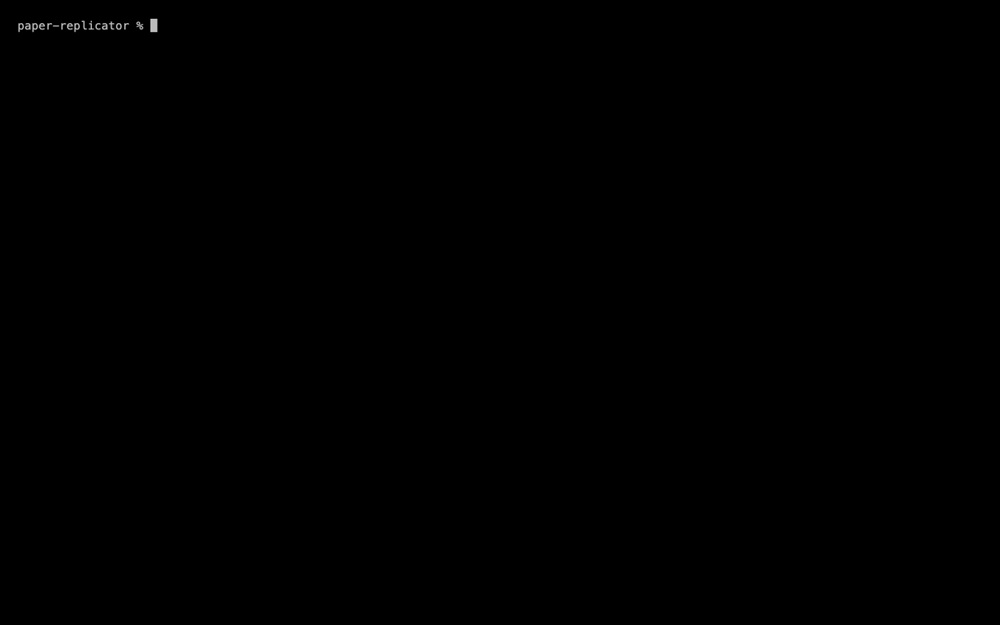

<h1 align="center"></h1>

<p align="center">
  <strong>An AI workflow that replicates scientific research.</strong>
</p>

<p align="center">
  Give it an arXiv paper. celsus reads the LaTeX, writes down every number the
  paper reports, rebuilds the analysis from public data in a sandbox, and tells
  you in plain words whether the published numbers hold up.
</p>

<p align="center">
  <a href="#see-it-in-30-seconds"><strong>Demo</strong></a> ·
  <a href="#vision"><strong>Vision</strong></a> ·
  <a href="#how-it-works"><strong>How it works</strong></a> ·
  <a href="#how-we-know-it-works"><strong>How we know it works</strong></a> ·
  <a href="#whats-next"><strong>What's next</strong></a> ·
  <a href="#use"><strong>Use</strong></a>
</p>

<p align="center">
  <a href="https://github.com/0ywfe/celsus/actions/workflows/tests.yml"></a>
  <a href="LICENSE"></a>
  
  
</p>

<p align="center">
  
</p>

<p align="center"><sub>The verdict line is held-out run 25b01b, the demo below.</sub></p>

Built during the Meta Global AI Developer Hackathon (Oct–Nov 2026). It runs on any chat-completions endpoint; the defaults are Meta's Muse models, and every run measured in this README used them.

The idea came from a March run, before this event, that scored 374 arXiv papers for replicability: 20 could be run again in full, and 3 were replicated by hand. None of that code is in this repository.

## See it in 30 seconds

No API key and no Modal token.



```bash
uv sync
uv run celsus demo     # replays a held-out run shipped with the package, labelled as a replay
```

The demo is run 25b01b from the held-out set below (arXiv 2610.04221, robust enhanced index tracking): 84 of 84 checked results match, its main result 0.4531 in the paper and 0.4482 ± 0.2654 here. Its report and the script that produced it are in `src/paper_replicator/cli/demo/`.

## Vision

People publish more research than anyone can keep up with, and few published results are ever run again. Replicating a paper by hand is slow, skilled work that is rarely funded or published, so it happens late and to a handful of well-known papers. When it is done, many results fail: the Open Science Collaboration re-ran 100 psychology studies, and 97% of the originals were significant against 36% of the replications (Science, 2015). In finance, Hou, Xue & Zhang (2020) found that about two-thirds of 452 published anomalies fail to replicate, while Jensen, Kelly & Pedersen (2023) found that most do. When experts disagree about a whole field, the way to settle it is to check each paper.

Software had the same problem and solved it with continuous integration: nothing merges until the tests pass. celsus does that for papers. The goal is a public library of checked papers: every empirical paper built on public data checked soon after it appears, with the script, the numbers and the verdict open to anyone who relies on it, from readers and referees to editors, funders and the next team building on the result.

<p align="center">
  
</p>

That is realistic now because a model can read a paper and write the analysis, and an open-weights model can do it cheaply. A run takes a median of 35 minutes and $1.34 at list prices on Meta's Muse Spark Open. One run on each of the 6,552 arXiv papers the held-out set was drawn from would cost about $8,500, at the mean of $1.30 a run.

The method isn't tied to a field. The rules for when a number matches come from replication practice across the sciences (table below), and the guards against typed-in results and trimmed samples apply to any paper. What a new field needs is a way to fetch its data. Finance and economics came first because their data (prices, filings, macro series) is public and a script can fetch it. Any computational field with public data has the same shape: social science on public surveys, climate on public reanalysis data, machine learning on public benchmarks.

This repository is the first version, open source under AGPL-3.0. The rest of this README is what it does today.

## How it works

1. It fetches the arXiv source and inlines its `\input` files. Muse writes a typed spec: the hypothesis, sample, method steps and every reported number, each copied exactly as printed.
2. Code checks that every number in the spec appears in the LaTeX, and that every cross-reference names a real claim. A spec with bad references gets one more attempt with the problems listed.
3. It checks the paper's own arithmetic. Do the subgroup counts add up to the total? Which p-value does each printed t actually give, at the precision both are printed to? This is how one-tailed tests are found.
4. Muse builds the replication inside a Modal sandbox with `run` and `write_file` tools: it explores the data, writes `replicate.py` and runs it.
5. Only an independent run of the final script, in a fresh sandbox, counts.
6. If the rebuilt sample doesn't match the paper's counts, the builder gets the gap back and tries again. It is never told to hit a number.
7. Code, not a model, compares each number (rules below) and writes the report.

### When a number matches

<p align="center">
  
</p>

The tolerances come from published replication practice, not from a chosen percentage. The one that doesn't, an allowance for small subgroup counts, says so in every report row it passes:

| kind | consistent when | source |
|---|---|---|
| estimate with a standard error | the paper's value lies inside the reproduction's 95% interval | the "original inside replication CI" criterion |
| number with no sampling error (a return over a fixed period, a ratio) | it rounds to the value as printed, or else lies within 10% of it | exact reproduction: Baek & Pradel, arXiv 2602.10046; 10% threshold: Hans & Bilionis, arXiv 2607.02134 |
| test statistic | the same conclusion at 5% on the side the paper tested: significant results stay significant in the same direction, null results stay null whatever their sign | Open Science Collaboration (2015) |
| p-value | same side of 0.05 | |
| sample total (the largest count, and the totals of the paper's partitions) | within ±15% of the paper's | SCORE's tolerance for sample size: Miske et al. (2026), Nature 652:126–134 |
| any other count (a subgroup) | within ±15% of the paper's, or else within 1.96 √n | SCORE, as above; the √n band, an allowance for small subgroups (the wider of the two below about 171), has no published source |

### Verdicts

A paper holds up, partly holds up or does not hold up by the share of its checked numbers that match. It holds up only if its main result was judged and matched, and it fails only if its main result was judged and missed.

"Could not check" is the checker's own failure, given with its reason: the data was unavailable, the sample couldn't be rebuilt, or the code crashed. The checker never blames a paper for its own failure.

### Guards

- Numbers the paper reports may not appear in the code, and the sample may not be trimmed or padded to a reported count.
- Market data goes through one logged module (cache, then yfinance, then a host-side fetch), and the report says which source and fetch date each series came from. Anything else the script downloads in Python (filings, macro series, exchange prices) is recorded by host, and the report lists those hosts too.
- The builder may not fetch the authors' code: re-running their code isn't replicating the paper. Data files are fine.
- Secrets are redacted from everything the model sees, and every run has a budget stop.

## How we know it works

### A held-out set nobody had looked at

<p align="center">
  
</p>

32 finance and economics papers from arXiv (Sep 2025 to Oct 2026), drawn from 6,552 arXiv hits by a rule written down before any run: public data a script can fetch, LaTeX source, about 30 minutes of compute, no paper seen during development. Abstracts were read with their numbers masked, and 12 papers were dropped because someone had glimpsed a result. The list was frozen before the first run.

Each paper ran twice on Muse Spark Open at effort xhigh, with a $2 budget stop per run. 63 runs finished, with a median of 35 minutes and $1.34 at list prices. Four runs the host cut off were set aside as infrastructure failures; three were run again, and one paper's second run stopped after its second cut. The headline, as run, on the code frozen for the test: holds up 1, partly holds up 26, does not hold up 3, could not check 28, and could not check at the $2 budget stop 5.

"Could not check" is the checker's own failure, given with its reason: the data was unavailable, the sample couldn't be rebuilt, the code broke a rule, or nothing comparable came out. It never counts against the paper.

A replay of the same stored attempts under the post-headline scorer gives holds up 1, partly holds up 27, does not hold up 0, could not check 30, could not check (budget) 5. This is not a fresh test, as the fixes were written after reading these runs. The three "does not hold up" each missed every number checked while the paper's main result was never computed; a paper now fails only on its main result. Two coded checks raised false alarms that decided held-out verdicts, and both were fixed after the headline: a sample period printed as two dates was read as its first date, and a minimum-length check was read as cutting the sample to the paper's count. The run that check stopped (8dd383) has no results to re-score.

The held-out set's 67 runs (reports, scripts, call logs) are in [`receipts/`](receipts/), one row per run with its verdict as run and under the replay; the development runs are not.

### Sabotage battery

<p align="center">
  
</p>

The battery plants faults into clean runs (results typed in from the paper, samples cut or padded to the paper's count, synthetic data, altered paper numbers) and counts what the checks catch. Of 116 viable plants, the coded checks alone catch 94; with one review, 106 (91.4%); with the union of two reviews, 108 (93.1%). The reviews raised no false alarm in 12 reviews of untouched scripts. Ten secret-leak plants are equivalent mutants (the sandbox only ever gets a stand-in for the secret) and are left out of the 116.

### Two independent reviews, read finding by finding

Every script is reviewed twice, independently, and a finding from either review sends it back. In the held-out set, 46 findings came from only one of the two reviews. Each was read against the script by hand: 43 true, 2 borderline, 1 false. No false or borderline finding decided a verdict.

### Tests and a regression gate

The test suite runs offline on every push (the badge above): model calls, the sandbox and market data are faked, and the guards are tested on real scripts from live runs. Before any change merges, a regression gate re-scores every stored run (215) and re-checks every stored plant (130); a verdict that changes has to be named, with its reason, in its own commit. Of the stored runs, only the held-out set's are in this repository (`receipts/`).

### Open weights

Every model call in the held-out set, 3,172 of them ($84.11 at list prices), ran on Muse Spark Open, Meta's open-weights model, served by Fireworks and Baseten: the reading of the paper, the build, and both reviews.

## What's next

Where the checks stop today, and what closes each gap.

- Papers that print no standard errors can't have their estimates judged yet, so they come back "could not check" even when the numbers match: one held-out paper matched 148 of its 170 estimates exactly. Next: a rule for them, taken from published replication practice like the others.
- A script can type the paper's sample size in as a plain number, and the code can't yet tell it from a design number such as a count of draws. The reviews catch these today: the stored runs hold 97 such counts, most of them design counts by our read, and the reviews named 13 as breaches. Next: a coded check.
- Data made up with a random generator and passed off as the paper's sample is caught by the reviews, not the code: in one run, one of the two reviews caught it. Next: trace random draws into the sample in code.
- A result rebuilt from the paper's own numbers is caught when the script writes it as arithmetic, including numbers spelled as text or string lengths. Next: follow it through dict and list constants, `max`, `np.where`, helper functions, and `**` and `+`.
- Small subgroup counts pass within 15% of the paper's, or else within 1.96 √n. That second band is the one rule here without a published source. Next: let an off subgroup count leave only its own results unjudged, then drop the band.

## Judging criteria

| criterion | evidence |
|---|---|
| Impact | Results that don't replicate cost everyone who builds on them (examples under Vision). celsus checks a paper end to end, from its LaTeX to a verdict in plain words, in a median of 35 minutes and $1.34, and the method carries to any field with public data. The held-out headline above is what it does on papers nobody had looked at. |
| Use of Meta AI tooling | Muse reads the paper into a typed spec, chooses the main result, builds the replication as an agent with tools in a sandbox, and reviews its own script twice. Muse Spark Open did every call of the held-out set; Muse Spark and Muse Wonder run behind the same flag (`--model`). On one tuning paper (n=3 per model), Muse Spark at minimal effort ($0.20 a run) and Muse Wonder at max effort ($1.75 a run) both match the paper's main result of -3.07% (Spark -3.155 to -2.946, Wonder -3.086 each time); Wonder costs 8.9× as much. |
| Technical depth | Code, not a model, judges every number, with tolerances from published replication practice (table below). Coded guards stop typed-in results, samples trimmed or padded to a count, and fetching the authors' code; the sabotage battery measures them, and the regression gate pins them. |
| Demo | `uv run celsus demo` replays a held-out run with no key. `celsus check <arxiv id>` runs a paper live, with each role on screen. |

## Use

```bash
uv sync
cp .env.example .env            # MODEL_API_KEY, SEC_USER_AGENT
uv run modal token new          # the sandbox runs on Modal

# check a paper and watch it live: stage tracker, live log, verdict card
uv run python -m paper_replicator.cli check 2512.06144 --model muse-spark-1.3 --require-provider meta

# replay a recorded run (labelled as a replay, with its run ID and date)
uv run python -m paper_replicator.cli replay <run-id> --speed 10

# replay the held-out run shipped with the package: no API key, no Modal token
uv run celsus demo

# many runs, and how reliable the result is
uv run python -m paper_replicator.batch 2512.06144 --n 5 --parallel 5 --model muse-spark-1.3 --effort minimal \
    --require-provider meta
```

<details>
<summary><strong>Models and providers</strong></summary>

A run defaults to Meta's Muse Spark (`muse-spark-1.3`) in every role. `--model muse-wonder-1.0` runs it on Muse Wonder, and `--effort` sets the reasoning effort (minimal to max) of the extractor, chooser and builder. The script is reviewed twice, independently, always at high effort whatever the run's setting, and a finding from either review sends it back. Any other chat-completions endpoint can be added in a local `providers.local.json` (format in `src/paper_replicator/local.py`) and chosen with `--provider`. `--require-provider meta` stops a run before any call that would go elsewhere; every benchmark here ran with it.

</details>

<details>
<summary><strong>What a run writes</strong></summary>

Each run writes `runs/<run-id>/`: `report.md` (the first line is the plain-words verdict), `comparison.json`, the spec, every script the builder wrote, sandbox logs, `events.jsonl`, and `calls.jsonl` (provider, model, tokens and cost of every call).

</details>

## Development

```bash
uv run pytest
```

Offline only: the agents talk to a fake model endpoint, and the sandbox is a fake too. Guards are regression-tested on real scripts from live runs (`tests/corpus/`).

## License

[AGPL-3.0-only](LICENSE)

---

Not financial advice. It checks what academics published. AI can make mistakes: check the code and data in the report.
